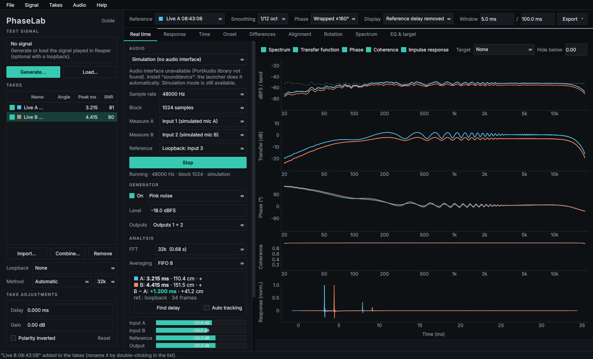
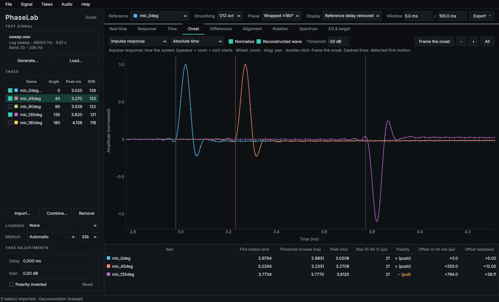
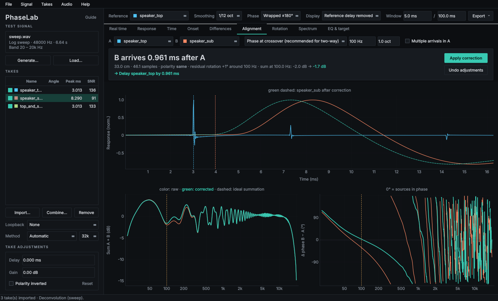
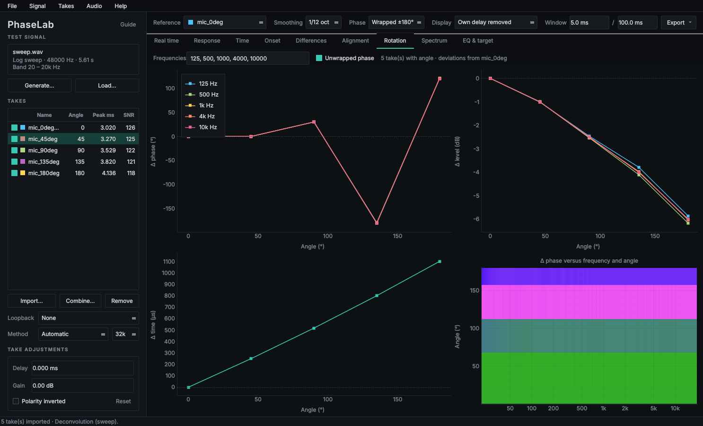
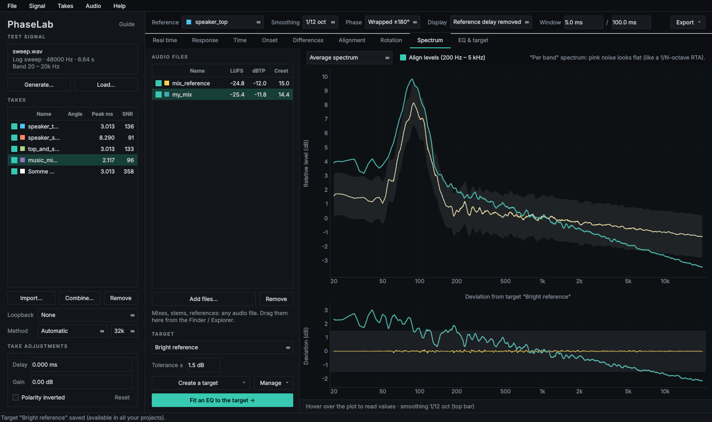
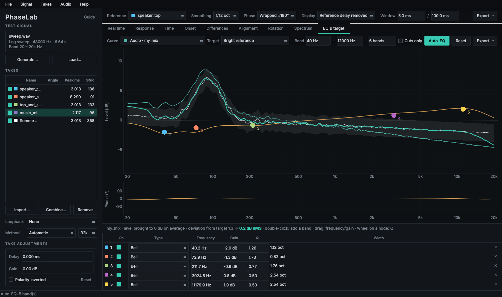

# PhaseLab

**Phase, delay and frequency-response analysis for microphones and loudspeakers,
with a real-time dual-channel analyzer, a mix analyzer and a parametric EQ.**

PhaseLab answers the questions you have in the studio and at front of house:
*how does rotating this mic change the phase? How many milliseconds separate
these two speakers? Which way does the wave start? How far is my mix from my
reference?* It generates its own test signals, so the analysis always knows
exactly what was played. You can then measure in two ways: record in Reaper
(or any DAW) and drop the files in, or measure live through your audio
interface, the way Open Sound Meter or Smaart do.



---

## Contents

- [Features](#features)
- [Quick start](#quick-start)
- [Three ways to work](#three-ways-to-work)
- [Tabs](#tabs)
- [Measurement methods](#measurement-methods)
- [Tips](#tips)
- [Project layout](#project-layout)
- [Requirements](#requirements)

---

## Features

- **Test signal generator**: synchronized log sweep, repeated sweeps, white,
  pink and brown noise, periodic noise, MLS, sine and impulse. Each WAV comes
  with a small `.phaselab.json` file that describes it exactly.
- **Real-time dual-channel analyzer**: spectrum, transfer function, phase,
  coherence, impulse response and level meters. Delay is found automatically,
  with a live B − A offset between two mics.
- **Onset view**: zoom down to the individual sample, with the real waveform
  reconstructed between samples (sinc ×16). Shows first motion, polarity
  (push / pull), rise time and offsets in µs and samples.
- **Speaker alignment**: finds the delay and polarity between two speakers by
  peak, by first motion or by **phase at the crossover**, then applies the
  correction with one click.
- **Mic rotation**: phase, level and time versus angle. The angle is read from
  the file name (`snare_45deg.wav`).
- **Differences and settings table**: delay (ms / samples / cm), polarity,
  residual phase rotation and gain to apply to each take, plus summation
  before and after correction.
- **Mix analyzer**: average spectrum (pink = flat), spectrogram, integrated
  LUFS (ITU-R BS.1770), true peak and crest factor.
- **Targets**: create a tonal target from a reference mix or from the average
  of several mixes. Targets are kept across projects and can be imported or
  exported (JSON, REW text, CSV).
- **Parametric EQ** on any curve, with draggable nodes and **Auto-EQ** to the
  target. Export the settings for ReaEQ, or export the exact EQ as a WAV for
  ReaVerb.
- **Projects**: every take, adjustment, target and EQ is saved in a
  `.phaselab` file.

Dark, minimal interface. Hover over any plot to read exact values.

---

## Quick start

You need **Python 3.10 or newer** ([python.org](https://www.python.org/downloads/)).

```bash
git clone https://github.com/kazenotodoroki/PhaseLab.git
```

Then:

- **Windows**: double-click `Launch PhaseLab (Windows).bat`
- **macOS**: right-click `Launch PhaseLab (Mac).command` › Open. The first
  time, you may need `chmod +x "Launch PhaseLab (Mac).command"`.

The first launch creates a virtual environment and installs the dependencies
(about a minute). Later launches start right away.

Manual install:

```bash
python -m venv .venv
source .venv/bin/activate        # Windows: .venv\Scripts\activate
pip install -r requirements.txt
python phaselab.py
```

### Try it without recording anything

| Example | What to do |
|---|---|
| `examples/mic_rotation/` | Drag every file into the window. Five mic takes from 0° to 180°, with known delays, polarities and phase rotations. |
| `examples/speakers_and_mix/` | Drag in `sweep.wav`, `speaker_top.wav` and `speaker_sub.wav`, then open **Alignment** (A = top, B = sub, crossover 100 Hz). |
| `top_and_sub_together.wav` | Both speakers in one take: in **Alignment**, tick *Multiple arrivals*. |
| `music_mic+loopback.wav` | Set **Loopback = Channel 2**, then import it: a dual-channel measurement made with music. |
| `mix_reference.wav`, `my_mix.wav` | Drag them into the **Spectrum** tab, create a target from the reference, then use *Fit an EQ to the target*. |
| Real time | **Real time** tab › *Simulation (no audio interface)* › **Start**. |

---

## Three ways to work

### 1. Record in Reaper, analyze in PhaseLab

1. **Generate** a signal (log sweep recommended) at your project's sample rate.
2. In Reaper, place the signal WAV at **0:00** on a track routed to the
   speaker. Use one armed track per mic with no input FX, and record from
   0:00.
3. Export with *File › Render › Stems (selected tracks)*, bounds *Entire
   project*, with no normalization and no dither.
4. Drag the files into PhaseLab.

Rendering from 0:00 keeps every take aligned to the signal. For the highest
accuracy, record a **loopback**: an interface output fed back into an input
and rendered in the same multichannel file. Then set its channel in
*Loopback*. Interface latency and coloration disappear, and **any signal
works**, including music.

### 2. Measure in real time

Open the **Real time** tab and choose:

- your interface;
- the mic input(s), A and optionally B;
- the reference: a loopback (most accurate) or the internal generator;
- the generator output and level.

Then press **Start**. The delay is found after 2 s. *Auto tracking* follows
it if you move the mic. **Store A / B** sends the current measurement to the
takes list, where Alignment, EQ and Differences can use it.

### 3. Analyze a mix

Drag mixes, stems or references into the **Spectrum** tab. No test signal is
needed. Compare tonal balance with levels aligned, check LUFS and true peak,
build a target, then open **EQ & target** to fit an EQ.

---

## Tabs

### Real time
Live dual-channel analyzer:

- **Generator**: pink, white or brown noise, periodic pink noise, continuous
  sweeps or sine.
- **Analysis**: FIFO or exponential averaging, FFT from 8k to 128k, optional
  coherence masking.
- **Comparison**: freeze spectra, overlay a target on the spectrum, or save
  the live spectrum as a new target.



### Onset
The start of the waveform, down to the sample. The dots are the samples; the
line is the reconstructed analog wave. Sources are the impulse response, the
step response, the raw recorded take, or any audio file. You can align the
traces by absolute time, by first motion or by peak.

In the screenshot above, the mics at 0°, 45° and 135° start 0, 250 and 794 µs
apart. The 135° mic starts with a **pull** (inverted polarity).

### Response
Level, phase, group delay and coherence of each take. The phase can include
the delay, remove the reference delay, or remove each take's own delay.

### Time
Impulse response, ETC envelope, and the take compared with the original or
the loopback. In *model* mode the residual contains only noise and
distortion.

### Differences
Level and phase difference against a reference take, summation before and
after correction, and a **settings table** for each take: delay, samples,
distance, polarity, residual rotation, gain, first notch of the sum, and the
correction to apply.



### Alignment
Instant offset between two speakers or two mics:

- **Phase at crossover** finds the delay and polarity that maximize A + B in
  the crossover band. This is the recommended method for a two-way system.
- **Peak** and **first motion** are time-domain alternatives.
- **Multiple arrivals** detects several arrivals in a single take (two
  speakers playing together). Strong reflections show up too.

*Apply correction* sets the take adjustments, and every tab then shows the
aligned result.



### Rotation
Phase, level and time difference versus mic angle at chosen frequencies, plus
an angle × frequency phase map.



### Spectrum
Average spectrum of any audio file, shown per band so that pink noise looks
flat, as on an RTA. Also a spectrogram, integrated LUFS, true peak (dBTP) and
crest factor. Targets come with a tolerance band and a deviation plot.



### EQ & target
Parametric EQ (bell, shelves, 12 dB/oct high/low-pass, notch, all-pass) on a
measurement, an audio file or a flat curve, for drawing a target.

- **Editing**: double-click to add a band, drag for frequency and gain, mouse
  wheel for Q.
- **Auto-EQ**: fits a set of bands to the target, with an optional *cuts only*
  mode.
- **Export**: ReaEQ settings (bandwidth in octaves), the exact EQ as a WAV
  impulse for ReaVerb, the curves as CSV, or the result as a new target.

---

## Measurement methods

The method is chosen automatically from the signal, or can be forced in the
sidebar.

| Signal | Method |
|---|---|
| Log sweep | Regularized spectral division (Kirkeby inversion), after Farina / Novak. Harmonic distortion falls into negative time and is discarded. |
| Periodic noise, MLS, repeated sweeps | Synchronous averaging of the periods, then exact circular deconvolution, with coherence across periods. |
| Noise, music, anything else | Dual channel, as in Open Sound Meter: automatic delay search (GCC-PHAT), averaged H1 = Sxy / Sxx transfer function (Welch), coherence. |

Shared processing:

- Absolute time reference: time 0 is the start of the signal file, or the
  loopback.
- Sub-sample peak by sinc interpolation.
- Half-Hann time window.
- Complex fractional-octave smoothing after removing each take's own delay.
- Joint estimation of delay and constant phase rotation.

Takes can be adjusted (delay, gain, polarity) and combined: vector average,
power average (minimum phase), sum or difference.

On simulated takes with known values, PhaseLab recovers:

- delays to 0.001 ms;
- polarity and gain (±0.01 dB);
- phase rotation (±0.1°);
- integrated loudness of the BS.1770 reference tone (−3.01 LUFS).

---

## Tips

- **Continuous sweeps in real time** build an accurate frequency response with
  long averaging (FIFO 16 or more). They are **not effective for time-domain
  measurement** (delay, impulse response, phase): use pink noise for those.
  PhaseLab shows a warning when a sweep or a sine is selected.
- PhaseLab and your DAW cannot share an interface opened in exclusive mode.
  Close Reaper while measuring in real time, or use a shared driver. On
  Windows, prefer the interface's ASIO or WASAPI driver. On macOS, allow
  microphone access for the Terminal.
- Start the generator around −30 dBFS and raise it gradually.
- If audio dropouts are reported, increase the block size.
- Name mic takes with their angle (`kick_out_30deg.wav`) so the rotation tab
  can read it.
- Keep each test signal next to its `.phaselab.json` file.

---

## Project layout

```
phaselab.py        main window
tab_live.py        Real time tab        live.py   real-time engine (audio I/O, analysis)
tab_attack.py      Onset tab
tab_align.py       Alignment tab
tab_rta.py         Spectrum tab         rta.py    spectrum, LUFS, true peak, spectrogram
tab_eq.py          EQ & target tab      eq.py     biquads, auto-EQ, targets
dsp.py             measurement engine (signals, deconvolution, dual channel, comparison)
widgets.py         shared UI pieces     style.py  theme
examples/          simulated takes and mixes to try the app
docs/screenshots/  images used in this README
```

`dsp.py`, `eq.py`, `rta.py` and `live.py` do not depend on the interface and
can be used from your own Python scripts.

Targets are stored in `~/.phaselab/targets/`. Live traces are saved next to
the project in a `<project>_traces/` folder.

---

## Requirements

- Python 3.10+
- numpy, scipy, soundfile, PySide6, pyqtgraph, sounddevice (see
  `requirements.txt`)

`sounddevice` brings PortAudio on Windows and macOS. On Linux, install
`libportaudio2` for real-time use. Everything else, including the real-time
**Simulation** mode, works without it.
